# 算法说明

**负责**：本项目用到的每个算法的输入、判定顺序、公式、阈值、复杂度与降级路径。
**不负责**：怎么操作界面（见 [web-guide.md](web-guide.md)）、规则条款的完整表述（见 [rules.md](rules.md)）、分层与模块边界（见 [architecture.md](architecture.md)）。
**权威来源**：代码本身。本文与代码冲突时以代码为准，并请顺手修文档——判定逻辑只有一处实现，文档也只能有一处。

文中的流程图、时序图、状态图用 Mermaid 编写：VS Code、GitHub、Typora 可直接渲染；在纯文本环境里按缩进与箭头方向阅读即可。

## 目录

- [1. 算法地图](#1-算法地图)
- [2. 端到端数据流](#2-端到端数据流)
- [3. 初始化](#3-初始化)
- [4. 拷贝](#4-拷贝)
- [5. 解密](#5-解密)
- [6. 标签读取](#6-标签读取)
- [7. 标签选择与补全](#7-标签选择与补全)
- [8. 文件名与标签匹配](#8-文件名与标签匹配)
- [9. 自检](#9-自检)
- [10. 去重](#10-去重)
- [11. 声纹识别与比对](#11-声纹识别与比对)
- [12. 归档](#12-归档)
- [13. 统一执行层 Plan](#13-统一执行层-plan)
- [14. 关键参数](#14-关键参数)
- [15. 已知局限](#15-已知局限)
- [16. 代码映射](#16-代码映射)

---

## 1. 算法地图

| # | 算法 | 唯一实现 | 输入 → 输出 | 副作用 | 降级 |
|---|---|---|---|---|---|
| 1 | 初始化判定与建库 | `core/library.py`、`services/steps.py` | 目录 + `music.db` → 状态与动作清单 | 建目录、建声纹库 | 无声纹工具时只建目录 |
| 2 | 拷贝 | `core/ops.py` | `(src, dst)` 列表 → 成功条数 | 写目标文件 | 单条失败不中断 |
| 3 | 解密 | `services/decrypt.py`、`decrypto/qq.py`、`decrypto/um.py` | 加密文件 → 明文音频 | 写产物、处理加密原件 | Frida → um → 报错 |
| 4 | 标签读取 | `core/tags.py` | 路径 → 标签/时长/封面 | 无（只读） | 缺 mutagen 全空 |
| 5 | 标签选择与补全 | `tagger/__init__.py`、`core/scoring.py` | 曲目 + 网络 → 标签/封面/歌词 | 写标签、写 `.lrc` | 声纹失败转在线；在线失败留空 |
| 6 | 文件名 ↔ 标签匹配 | `core/naming.py`、`core/check.py` | 曲目 → `ok/mismatch/skipped` | 无 | 不可比时 `skipped` 而非报错 |
| 7 | 自检 | `core/check.py` | 曲目列表 → `CheckResult` | 无（只读） | 读不出的项跳过 |
| 8 | 去重（集合内 + 跨集合） | `core/dedupe.py`、`core/quality.py` | 曲目集合 → 重复组 / 比对结论 | 无（只出结论） | 规格读不出转 `unknown` |
| 9 | 声纹识别与比对 | `fingerprint/`（`matcher`/`acoustid`/`musicbrainz`/`similarity`）、`services/soundalike.py` | 音频 → AcoustID 录音 / soundalike 重复组 | 写声纹库 | 缺 fpcalc/网络则跳过 |
| 10 | 归档 | `core/organize.py` | 曲目 + 基准目录 → `<年代>/<年份>/` | 经 `Plan` 移动 | 标签不全进 `unknown/` |
| 11 | 统一执行层 | `core/ops.py` | `Operation` 列表 → 结果 + journal | 移动/改名/入回收站 | 单条失败不影响整批 |

三条贯穿全局的约束（后文反复用到）：

1. **判定在 `core/`，副作用在 `services/`**。`core/` 不算网络、不调外部程序、不写盘。
2. **破坏性动作只有 `core.ops.Plan` 一个出口**，删除一律是移入 `log/_trash/`。
3. **宁可 `unknown` 转人工，也不猜**。读不到时长/规格/元数据时一律降级，不自动搬运。

---

## 2. 端到端数据流

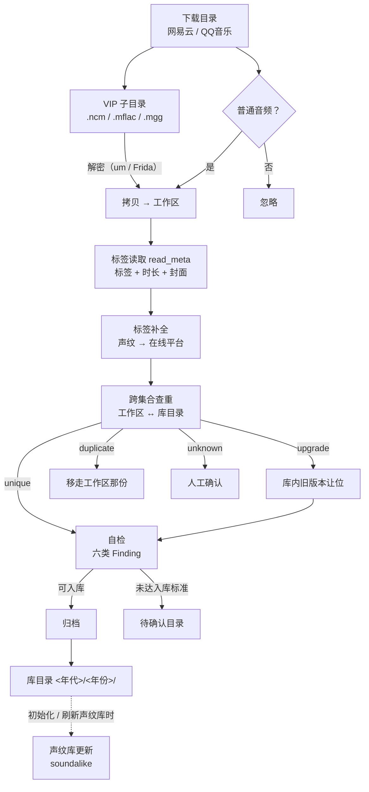

八步向导与上图一一对应（第 1、2 步是配置与初始化，不搬文件）。每步的目录语义见 [workflow.md](workflow.md)，本文只讲算法。

---

## 3. 初始化

### 3.1 状态判定

`core.library.status()` 是「库是否已初始化」的唯一判据。判定顺序固定：

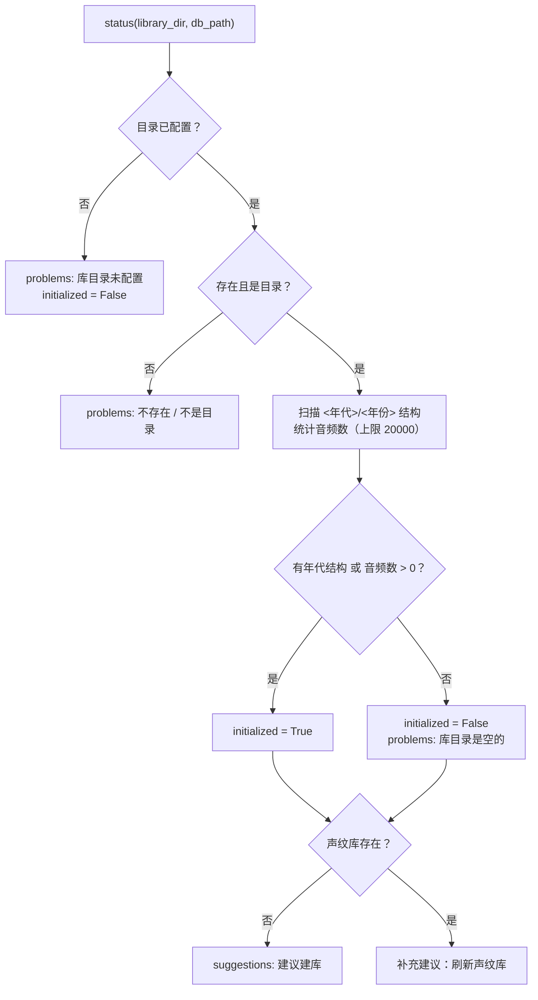

关键取舍：

- **声纹库缺失不算未初始化**。库目录能用就先算初始化完成，`music.db` 是可单独补建的能力，列在 `suggestions` 里。
- **音频计数有上限**（`AUDIO_COUNT_LIMIT = 20000`）。判断「库是不是空的」不需要走完两万首；超过上限时 `count_truncated = True`，页面标注「≥」。
- **跳过目录**（`core.scan.SKIP_DIRS`）：`_trash`、`_decrypt`、`.git`、`__pycache__`、`.sisyphus`、`unknown`，以及任何以 `.` 开头的目录。回收站里的文件不能计入「库里有内容」。

### 3.2 动作清单

`init_actions()` 把状态翻译成可展示的动作，规则是**只列缺什么**：

| 条件 | 动作 | 语义 |
|---|---|---|
| `not is_dir` | `mkdir` | 创建库目录 |
| `not has_year_layout` | `layout` | 建 `unknown/` 与工作/暂存目录 |
| `not db.exists` | `db` | 扫描库目录写入指纹 |
| `db.exists` | `db-refresh` | 增量补指纹（已有指纹不重算） |

### 3.3 执行（幂等）

`services.steps.init_library()` 只做四件事，全部幂等，**不动任何已有文件**：

```
1. 库目录不存在 → makedirs
2. utils.ensure_dirs() → 工作区 / 待确认 / 重复 / 两个暂存区 / 报告 / 回收站
3. 库目录下建 unknown/（归档兜底桶）
4. 声纹库不存在（或用户要求刷新）→ soundalike.init_db()
```

声纹库这一步有个前置校验，见下节。

### 3.4 指纹参数一致性

soundalike 把 `-fpcalc-length` 写进库的 `Settings` 表，**参数与库不一致时直接拒绝打开库**。所以开跑前先只读探测：

```
db_fpcalc_length():  sqlite3 以 mode=ro 打开 music.db
                     → SELECT Desc FROM Settings
                     → 解析 "length=120,..." 中的 length
                     → 与 config.FPCALC_LENGTH 比较（容差 0.001）
```

不一致时给出可照做的提示（删库重建，或改 `config.ini` 的 `fpcalc_length`），而不是抛一个返回码 1。改 `fpcalc_length` 等于换了一套指纹，必须重建库——这一点没有兼容路径。

---

## 4. 拷贝

拷贝**不是破坏性操作**，因此不进 `Plan`，走 `core.ops.copy_items()`。但它同样要处理重名与歌词伴随，否则工作区会出现「音频进去了、歌词没跟进」或「同名覆盖了已打好标签的版本」。

### 4.1 候选枚举

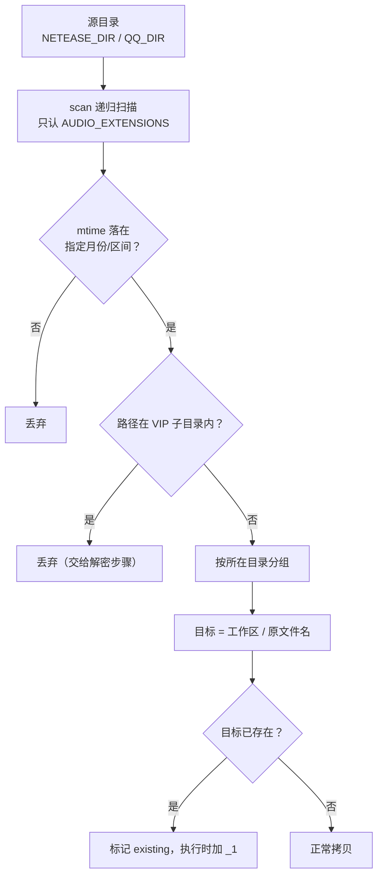

两点值得注意：

- **月份过滤用 `mtime` 而不是文件名**。下载工具的命名风格不统一，只有文件系统时间可靠；月份格式 `YYYYMM`，区间比较直接用字符串（闭区间）。
- **VIP 子目录显式排除**。加密文件混在下载目录里，若被当普通文件拷进工作区，后续会以「缺标签」的名义被搬进待确认目录，等于把用户的原件弄乱。

### 4.2 执行时序

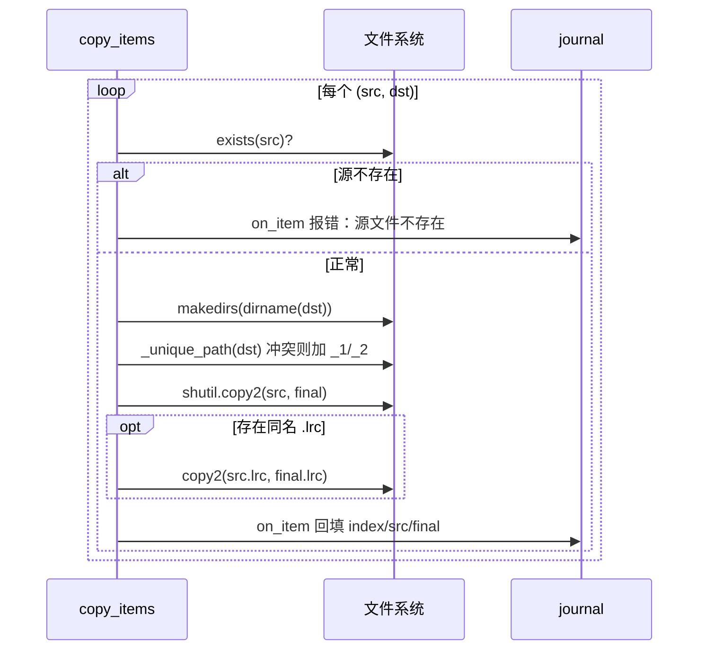

- `copy2` 保留 `mtime`——后续按月份筛选、按时间排查都依赖它。
- 重名策略是**追加 `_1`、`_2`**（`_unique_path`），不覆盖。覆盖会静默销毁工作区里已补好标签的版本。
- 逐条回调 `on_item(index, src, final, error)` 让页面能显示每一行的落点，而不是最后只剩一个「成功 N 个」。

---

## 5. 解密

### 5.1 通道选择

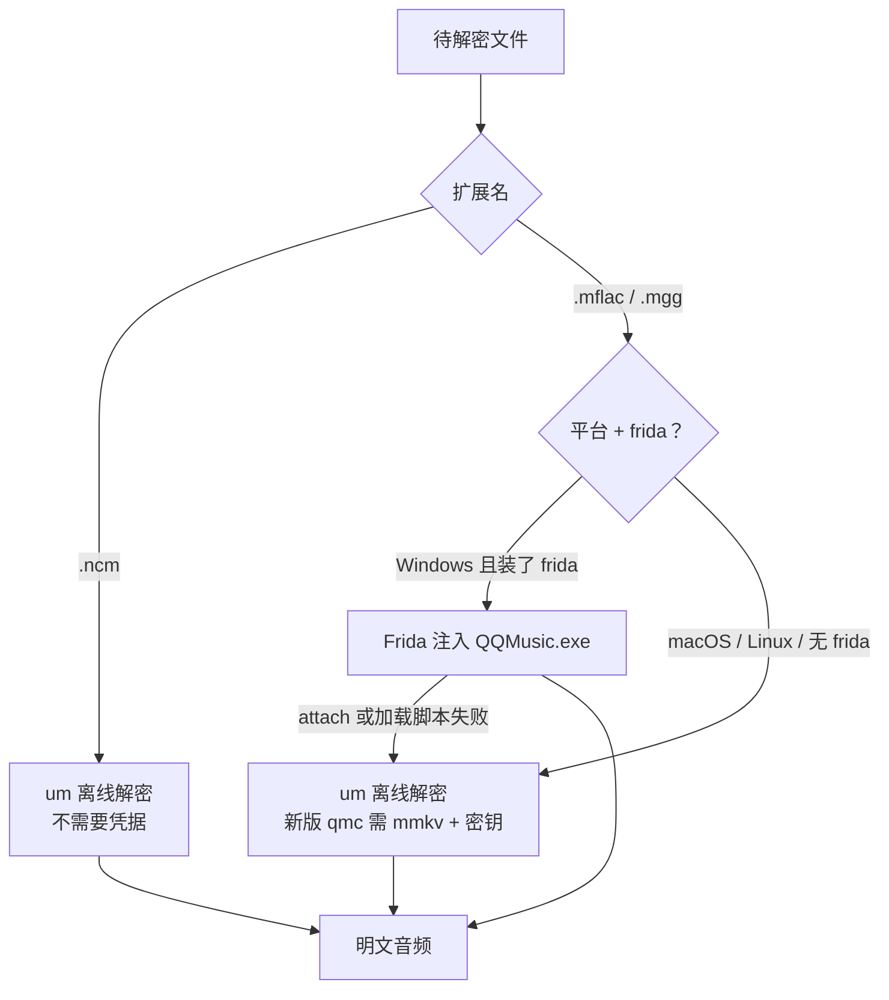

`decrypt_backend()` 的判据只有两条：`os.name == 'nt'`（且不是 darwin），以及 `import frida` 成功。macOS 版 QQ 音乐是 Mach-O 应用，没有 `QQMusicCommon.dll`，也没有那套 MSVC 修饰的导出名，换 Frida 也定位不到函数，所以固定走 um。

### 5.2 Frida 通道：为什么必须复制再解

时序如下（`decrypto/qq.py` 的 `_run_frida`）：

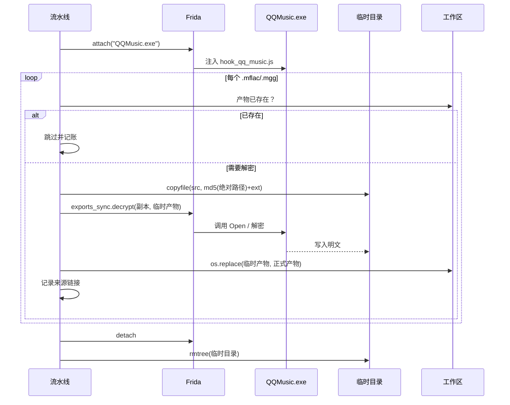

三个非显然的设计点：

1. **必须复制到临时目录再解**。`EncAndDesMediaFile::Open` 会截断传入路径，直接把用户原件交给它等于毁掉原件。副本名用**完整路径的 MD5**，因为不同子目录可能有同名文件，用文件名会互相覆盖。
2. **`os.replace` 才落到正式位置**。中途失败时删除的是临时产物，工作区不会出现半截文件。
3. **先判产物是否已存在再解**。重复解密既慢又可能覆盖已经补好标签的文件。

### 5.3 um 通道

| 场景 | 调用粒度 | 原因 |
|---|---|---|
| 网易云 `.ncm` | 整目录一次 | 不需要凭据，且 um 逐字节写目标 |
| QQ `.mflac/.mgg` | **逐文件** | um 处理目录时遇一个坏文件就 `FATAL` 退出，整批不处理 |

凭据规则（`decrypto/um.py`）：`mmkv` 与 `key` **必须成对**。只给 mmkv 时 um 会去开 vault 并因 `unexpected EOF` 失败，连本来不需要凭据的旧版 qmc 也一起解不开。所以凑不齐就两个都不传。

逐文件调用的另一个好处是错误能精确到文件：`failure_detail()` 从 stderr/stdout 里优先挑 `FATAL` 行，其次含 `error` 的行，最后取最后一行。

### 5.4 两条解密路线

| 路线 | 入口 | 加密原件去哪 | 适用 |
|---|---|---|---|
| 暂存区路线 | `_decrypt()` | 移入暂存区 → 解密 → 按 `ENCRYPTED_SOURCE_MODE` 归还/入回收站/保留 | 旧流程、批量 |
| 直接路线 | `decrypt_direct()` | 原地不动（`trash` 模式才入回收站） | 向导默认 |

直接路线省掉两次跨盘复制：原来「搬进暂存区」一次、「归还」再一次。um 本身是「读源 → 逐字节写目标」，输入输出在不同盘符也能写，没有必须同盘的理由。

暂存区路线判定产物用**快照差集**，而不是猜文件名：

```
before  = 工作区全部文件的相对路径集合（排除暂存子目录）
runner()
after   = 工作区全部文件的相对路径集合（排除暂存子目录）
produced = after - before
```

这比「按 stem 猜扩展名」可靠：`.ncm` 里可能是 mp3 也可能是 flac，扩展名由内容决定。

### 5.5 加密原文件去向

`ENCRYPTED_SOURCE_MODE` 默认 `return`。三种取值构成一个封闭状态机：

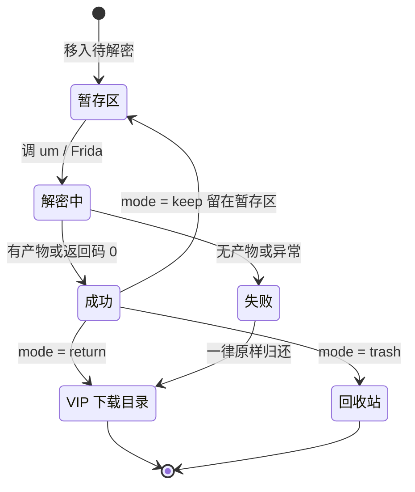

**失败一律归还**，不看 mode。失败还留在暂存区，用户会以为文件丢了。

### 5.6 边界

- **只处理本次移入暂存区的那几个文件，或 Web 直解时用户已选的文件**。不遍历 VIP 目录、
  不遍历暂存区顶层——旧实现「把 TEMP 顶层所有文件搬走」正是误伤用户文件的来源。
  Web 直解不经过暂存区，原文件默认留在原地，只有 `trash` 模式才把已选的原件移入回收站。
- **`--remove-source` 不使用**。加密原件由 `Plan` 统一管，外部程序不许自己删。
- **`--overwrite` 默认不加**。目标存在时 um 打一行 `output file already exist, skip` 正常退出，不会覆盖工作区里已打好标签的同名文件。

---

## 6. 标签读取

`core.tags.read_meta()` 一次打开读出三件事，是扫描阶段唯一入口：

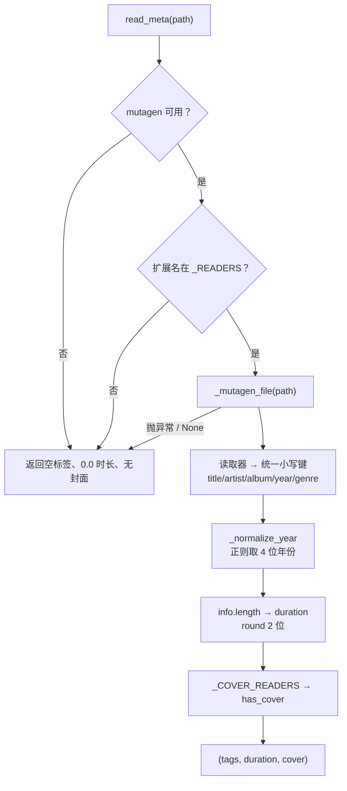

为什么必须是「一次打开」：分别调 `read_tags` / `duration` / `has_cover` 会把同一个文件完整解析三遍。一万首的库上这是十几分钟与一分钟的差别。

格式映射是**成对维护**的（`_READERS` 与 `_COVER_READERS`）。只加扩展名不加读取器，整类文件会被判成「缺标签」搬进待确认目录——`tests/test_tags.py` 专门拦这种漏改。

四个读取族的差异：

| 族 | 格式 | 键名 | 取值 |
|---|---|---|---|
| ID3 | mp3 / wav / dsf | `TIT2` `TPE1` `TALB` `TDRC` `TCON` | `str(frame)` |
| Vorbis | flac / ogg / opus | `title` `artist` `album` `date` `genre` | 取列表首项 |
| APEv2 | ape | `Title` `Artist` `Album` `Year` `Genre` | 取列表首项 |
| MP4 / ASF | m4a / wma | `\xa9nam`… / `Title`… | 取列表首项 |

封面判定按容器分别实现：ID3 看 `APIC*` 帧、FLAC 看 `pictures`、ogg/opus 看 `metadata_block_picture`、APE 看 `Cover Art*`、MP4 看 `covr`、ASF 看 `WM/Picture`。**只认内嵌，不认同目录的 `cover.jpg`**——补封面写的是内嵌图，判定也必须看同一个位置，否则「报告说没有、工具认为已有」会互相打脸。

降级链：缺 mutagen → 全空；老版本 mutagen 缺某个可选模块 → 只少一种格式（`MP4`/`OggOpus`/`ASF`/`DSF` 各自独立 try-import），不能让一个可选格式拖垮全部读取。

---

## 7. 标签选择与补全

### 7.1 主流程

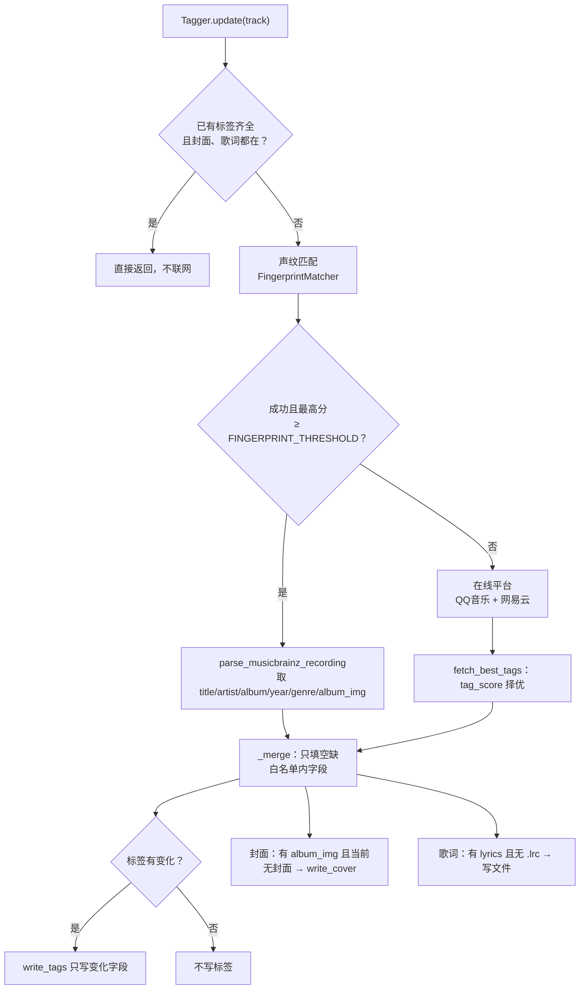

### 7.2 跳过条件（省的是网络开销，不是磁盘）

`update()` 开头先算 `missing_wanted`：白名单里有没有空字段。只有当**该补的都齐了、封面与歌词也都在**时才提前返回。声纹计算要调 fpcalc、AcoustID 要两次 HTTP，能跳就跳。

注意白名单语义：`fields=('title','artist')` 时，`album/year/genre` 空着也不影响「可以跳过」。用户关掉了某个字段，就不该为它付查询代价。

### 7.3 声纹优先，在线兜底

顺序固定：**声纹 → 在线平台**。理由是声纹基于音频内容，与文件名对不对无关；在线平台拿文件名去搜，文件名错了就搜错。

声纹分数低于阈值时**不降级使用**，直接转向在线平台。阈值 `FINGERPRINT_THRESHOLD` 默认 50。取所有候选里 `score` 最大的那条。

### 7.4 在线平台择优：`tag_score`

两个平台**依次查询、逐个打分**，某个平台拿到 100 分就提前结束（省一次网络往返）。

```
tag_score(tags, query_title, query_artist) ∈ [0, 100]

完整性（40 分）
  title   +10
  artist  +10
  album   +10
  year     +5
  genre    +5

匹配度（60 分）
  标题：完全相同 +30，互相包含 +20，不匹配 +0
  歌手：任一在线艺术家匹配（≥1 分）+30
```

底层比较是 `match_score`：归一化后（去空白、转小写）相同得 2 分，互相包含得 1 分，否则 0 分。多艺术家用 `split_artist` 拆开，取任一匹配的最高分——`周杰伦 & 方文山` 里匹配上 `周杰伦` 就算匹配。

### 7.5 合并策略：只填空缺

`_merge()` 的唯一规则：

```python
for key in self.fields:            # 保持 TAG_KEYS 顺序，前端字段顺序稳定
    if not merged.get(key) and new.get(key):
        merged[key] = new[key]
```

**已有值永不覆盖**。理由：文件里已有的标签可能是用户手工改对的，而在线平台对冷门曲目经常给出同名不同版本的结果。补全的定位是「填空」，不是「纠正」。

副作用是错标签也补不掉——所以提供了单曲编辑（`save_track`）作为人工纠正通道，它**不改文件名**：改名牵动重复判定、归档路径与 journal，属于归档环节的事。

### 7.6 封面与歌词

| 项 | 触发条件 | 上限 / 位置 | 失败处理 |
|---|---|---|---|
| 封面 | 有 `album_img` 且当前无封面且 `write_cover` | `MAX_COVER_SIZE` 默认 5 MB，`stream=True` 先看 `Content-Length` | 静默跳过，不影响标签 |
| 歌词 | 有 `lyrics` 且无同名 `.lrc` 且 `write_lyrics` | 写 UTF-8 文本 | `OSError` → `result.lyric = False` |

封面下载用流式响应，声明体积超限就不把整张图拉进内存；对不返回 `Content-Length` 的服务器再按实际大小兜底。

写封面成功后要**同步更新 `track.has_cover`**，否则同一轮里后续判定还在用「没有封面」，会重复下载。

歌词写盘失败不影响标签：标签已经写进去了，这一首下次补全还会再来。

### 7.7 声纹阶段的真实行为

`Tagger.update()` 调的是 `matcher.match_file(track.path)`，**没有传 metadata**。因此主流程走的是「按 AcoustID 合成分取最高」，而不是 `_find_best_match()` 的 Picard 加权相似度。

`_find_best_match()` 只有调用方显式传 `metadata` 时才生效（例如直接使用 `fingerprint` 模块的脚本）。看代码时容易误以为阈值卡的是 Picard 相似度，实际卡的是 AcoustID 合成分。这一区别在第 11 节展开。

---

## 8. 文件名与标签匹配

这是全项目最容易被「善意的宽松」写坏的一处：放松一点会把整张合辑搬进待确认目录，收紧一点会漏掉真正的错标。

### 8.1 文件名解析

`parse_filename()` 三级降级：

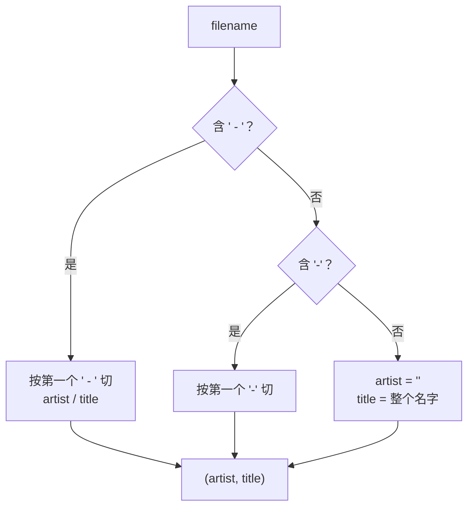

配套三个判定：

| 函数 | 语义 | 用途 |
|---|---|---|
| `is_canonical` | 有非空 artist、非空 title、且**含 `' - '`** | 自检报「文件名格式」 |
| `canonicalize` | 只在「**恰好一个** `-` 且没有 `' - '`」时改写 | 自动修名单一来源 |
| `format_filename` | 按标签生成规范名，清理非法字符 | 按标签改名 |

`canonicalize` 那个「恰好一个 `-`」的条件是为了不误伤 `AC-DC - Back In Black`。多连字符的名字交给人工，不猜哪个是分隔符。

### 8.2 归一化

```text
normalize_text(s) = 把 s 的全部空白去掉，再转小写
normalize_key(s)  = 先去掉括号噪声（(1)、[无损] 之类），再 normalize_text
```

去空白而不是压缩空白：中文歌名里空格写法极不统一（`七 里 香` vs `七里香`），压缩空格仍然不等。

### 8.3 歌手比对：三条放行规则

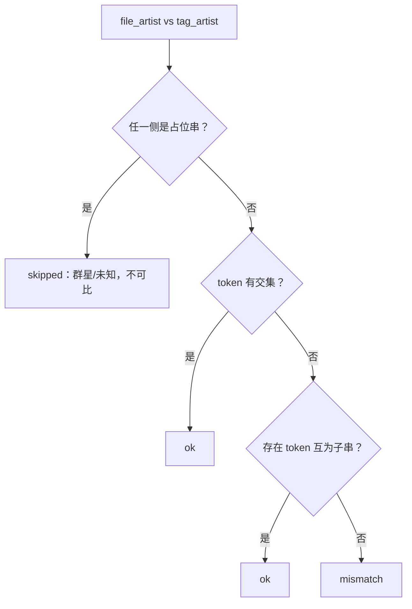

`artist_tokens()` 收录三种写法，这是多条放行规则能成立的基础：

```
周杰伦 (Jay Chou)
  → {'周杰伦(jaychou)', '周杰伦', 'jaychou'}
```

- 拆分后的每个歌手（`split_artist` 认 `; ， , & / 、 · |` 等 12 种分隔符）
- 去掉别名括号的主名
- 括号里的别名（再拆一次）

于是这些都被判一致：

| 文件名 | 标签 | 结论 | 依据 |
|---|---|---|---|
| `周杰伦 & 方文山` | `周杰伦` | ok | token 交集 |
| `周杰伦` | `周杰伦 (Jay Chou)` | ok | 主名 token 相同 |
| `周杰伦 feat. 杨瑞代` | `周杰伦` | ok | token 子串（`周杰伦` ⊂ `周杰伦feat.杨瑞代`） |
| `Various Artists` | 任意 | skipped | 占位串 |
| `陈奕迅` | `周杰伦` | mismatch | 无交集、无子串 |

占位串集合（`_PLACEHOLDER_ARTISTS`）包含 `various artists`、`群星`、`合辑`、`精选集`、`unknown`、`未知`、`佚名` 等。合辑里每首的标签歌手都是 `Various Artists`，文件名却是具体歌手——这不是错误，按矛盾处理会把整张合辑搬走。

### 8.4 歌名比对

比歌手简单，但同样三级：

```
归一化后相等            → ok
一方包含另一方           → ok
否则                    → mismatch
```

「一方包含另一方」放行的是 `晴天` vs `晴天 (Live)` 这类带版本后缀的写法。代价是 `晴天` 与 `晴天转多云` 也会判一致——这是刻意接受的漏判方向：**宁可漏判，不做误判**，因为误判会搬文件。

### 8.5 一致性报告

`consistency_report()` 输出结构化结果，页面与 `readiness_problems()` 共用这一份：

```json
{
  "ok": false,
  "problem": "歌手: 文件名「陈奕迅」≠ 标签「周杰伦」",
  "items": [
    {"field": "artist", "state": "mismatch", "file": "陈奕迅", "tag": "周杰伦"},
    {"field": "title",  "state": "ok",       "file": "十年",   "tag": "十年"}
  ]
}
```

三种 `state` 的语义必须分清：

| state | 含义 | 是否算问题 |
|---|---|---|
| `ok` | 一致（含放行规则命中） | 否 |
| `mismatch` | 矛盾 | **是**，且 `severe = True` |
| `skipped` | 该维度不可比（文件名无歌手结构 / 标签为空 / 群星） | 否 |

`skipped` 不是错误。把它当错误处理，所有 `Intro.flac`、`Track01.flac` 都会被判矛盾。

### 8.6 就绪判定

`readiness_problems()` 是「能不能入库」的唯一判据，判定顺序固定：

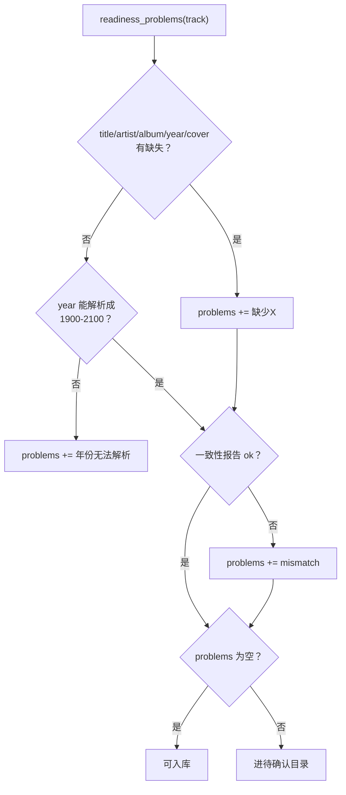

两个边界：

- **内嵌封面必须存在，歌词不参与判定**。缺封面算未达标，缺歌词只提示。
- **年份必须能落进目录**。`year_int` 要求 1900-2100 的四位数字，否则出现「判定可入库、却落进 `unknown/`」的两套结论。

`core/organize.py` 另有一套 `missing_fields()`（title/artist/year，不含 album）。两套并存是历史原因：归档只需要能定目录的字段，就绪判定要更严。修改时**不要合并**，否则一处放宽会同时改变两个语义。

---

## 9. 自检

### 9.1 六类 Finding

`check_library()` 一次遍历产出 `CheckResult`，只读不写：

| kind | 判据 | `fixable` | `severe` |
|---|---|---|---|
| `文件名格式` | `not is_canonical()` | 有目标名时 true | 否 |
| `标签不完整` | `missing_tag_fields()` 非空 | 否 | 缺**任一核心字段或内嵌封面**时 true |
| `文件名与标签不一致` | `consistency_report().problem` | 否 | **是** |
| `重复文件` | `find_duplicates()` 的 `drop` 侧 | 否 | 否 |
| `缺少歌词` | 无同名 `.lrc` | 否 | 否 |
| `孤立歌词` | `.lrc` 无对应音频 | 否 | 否 |

`severe` 的语义是「还没达到可入库状态，可以搬文件」。缺歌曲名/歌手/专辑/年份/内嵌封面，
或文件名与标签矛盾一律移入 `INCOMPLETE_DIR`；只有缺歌词、孤立歌词只报告。

顺序上先跑文件名/标签/一致性（逐曲目），再跑歌词（集合级），最后跑重复（需要全局视图）。重复放在最后是因为它要看到所有曲目才能聚类。

### 9.2 动作生成的三级优先级

`plan_fixes()` 不是「按发现顺序生成动作」，而是有严格优先级：

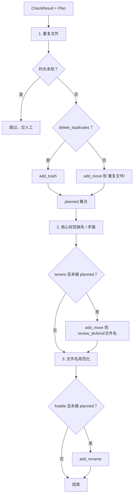

为什么是这个顺序：

- **重复优先**。一个文件可能同时「重复」且「缺标签」，先定它归谁，避免两条规则各搬一次。
- **`planned` 集合去重**。已决定搬走的文件不再改名——搬走后再改名会让 journal 里的路径对不上。
- **配置开关决定是否真的搬**。`move_bad` 为 false 时只报告；`delete_duplicates` 为 true 时重复文件进回收站而不是待处理目录。

### 9.3 报告渲染

`report_into()` 对每类 Finding 先写汇总行，再写明细表。**正文最多列 200 行**（`MAX_TABLE_ROWS`），超出的写提示并把完整清单落到 `review-*.csv`。一万行的 Markdown 表格没有人会读。

---

## 10. 去重

两种场景，两套算法，不要混用：

| 场景 | 函数 | 问的问题 |
|---|---|---|
| 同一堆文件内部 | `find_duplicates()` | 哪几个是同一首，留哪个 |
| 工作区 ↔ 库目录 | `match_against()` | 这份该不该入库，库里那份该不该让位 |

### 10.1 去重键：`version_key`

第一层的坑是「同名不同版本」。`晴天`、`晴天 (Live)`、`晴天 (Remix)` 是三首歌，不能互相判重；但 `晴天 (1)`、`晴天（2）` 是同一首的重复下载。

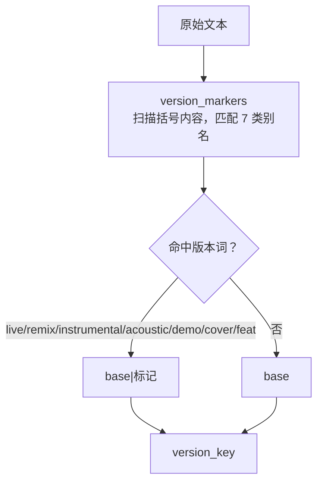

版本类别与同义词（`_VERSION_ALIASES`）：

| 类别 | 同义词 |
|---|---|
| `live` | live、现场、演唱会、concert |
| `remix` | remix、混音、dj、bootleg、rework |
| `instrumental` | instrumental、伴奏、karaoke、offvocal、纯音乐 |
| `acoustic` | acoustic、unplugged、不插电 |
| `demo` | demo、小样、session、outtake、未发行 |
| `cover` | cover、翻唱 |
| `feat` | feat、featuring、ft.、ft |

匹配前把 `[\s._\-·•]+` 全去掉，所以 `ft.` 与 `ft` 等价。`base` 是**去掉全部括号内容 + 去空白 + 小写**。

性质（可作为测试断言）：

```
version_key("晴天")           == "晴天"
version_key("晴天 (1)")       == "晴天"
version_key("晴天 (Live)")    == "晴天|live"
version_key("晴天（现场版）") == "晴天|live"
version_key("晴天 (Remix)")   == "晴天|remix"
```

`Track.key` 用 `(version_key(artist), version_key(title))` 作为去重键。

### 10.2 集合内查重：两条规则 + 时长聚类

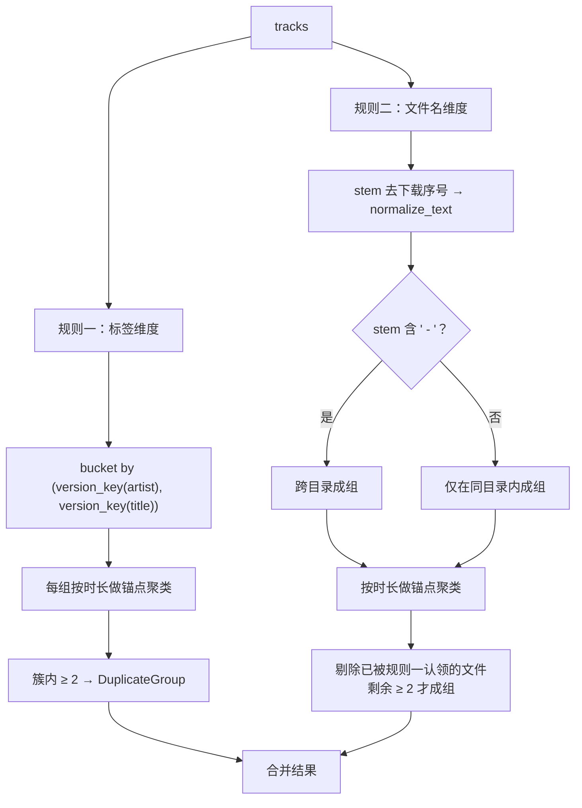

三个细节决定了漏判率：

**① 文件名维度按目录分域。** `Intro.flac` 拿不到歌手信息，跨目录同名多半是不同专辑里的不同曲目。只有带 `歌手 - 歌名` 结构的文件名才允许跨目录比较。

**② 文件名维度里，已被标签组认领的文件要剔除，但剔除后仍 ≥ 2 个就照常成组。**

```
文件名组 = [A, B, C]，其中 A 已被标签组认领
  → remaining = [B, C] → 仍成组 ✅
  → 不能因为「组里有一个被认领」就把整组丢掉，否则漏掉真正的重复
  → 只有 remaining < 2 时才放弃这一组
```

**③ 时长聚类是锚点聚类，不是链式扩张。**

```python
known   = 按时长排序的曲目
clusters = []
for t in known:
    if clusters and t.duration - clusters[-1][0].duration <= tolerance:
        clusters[-1].append(t)          # 与簇首（簇内最小）比较
    else:
        clusters.append([t])
unknown → 并入第一簇（或自成簇）
```

复杂度 `O(n log n)`（排序主导）。簇范围固定为 `[簇首, 簇首 + tolerance]`，不做链式扩张，因此不会出现「A≈B、B≈C 所以 A≈C」的漂移：100 / 102 / 104 秒、容差 3 秒时，104 距簇首 4 秒，独立成簇。

代价是**差值略大于容差的同一录音会分到两簇**（漏判）。这是容差参数的边界效应，方向上是漏判而非误判，交人工确认；要收紧只能调 `duration_tolerance`，不要改聚类方式。

`duration <= 0` 视为未知，并入第一簇并置 `duration_unknown = True`。这类组**不自动处理**（`plan_fixes` 直接跳过），因为读不出时长多半文件已损坏，损坏文件不该被自动搬走。

### 10.3 保留策略

```python
_QUALITY = {'.flac': 5, '.dsf': 5, '.wav': 4, '.ape': 4,
            '.ogg': 3, '.opus': 3, '.mp3': 2, '.m4a': 2, '.wma': 1}

_rank(track) = (_QUALITY.get(track.ext, 0), -track.size)
pick_keep    = max(tracks, key=_rank)
```

先比格式层级，同层同音质再留体积更小的文件（省磁盘）。**这是「留下哪个」的粗排，不是音质判定**；精确比较在 `core/quality.py`，只用于跨集合场景。

### 10.4 跨集合比对：`match_against`

这是入库前的最后一道闸。输出四种结论，对应四种处理：

| status | 含义 | 处理 |
|---|---|---|
| `unique` | 库里没有 | 照常归档 |
| `duplicate` | 库里已有同等或更好音质 | 移走**工作区**这份 |
| `upgrade` | 库里已有但更差 | 移走**库里**那份，工作区这份归档 |
| `unknown` | 判不出来 | 交人工 |

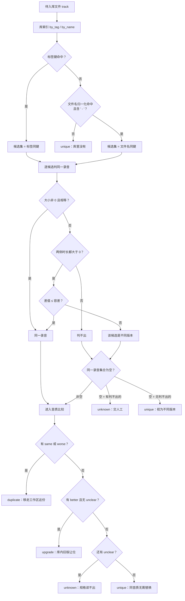

四个必须讲清的取舍：

**① 先比大小，再比时长。** 同一个文件的复制/移动，字节数一定相同，比读时长更可靠，而且不用打开文件。库索引刻意不读标签（一万多首逐个 mutagen 要十几分钟），只有命中候选后才按需 `probe` 读规格，通常个位数文件。

**② 库索引只填 `artist/title/size`。** 库里的文件是归档流程按 `歌手 - 歌名.ext` 写进去的，文件名本身就是可信来源。

**③ 大小与时都拿不到 → `unknown`，不判重复。** 损坏文件不应被自动移走。

**④ 音质打平时还有格式偏好。** 同规格的 WAV 与 FLAC 解码结果完全一致，但 FLAC 体积约一半。此时判 `upgrade` 但 `basis = 'format'`，与真正的音质升级（`basis = 'quality'`）区分开——页面上不能说成「音质升级」。

### 10.5 音质比较：两层决策

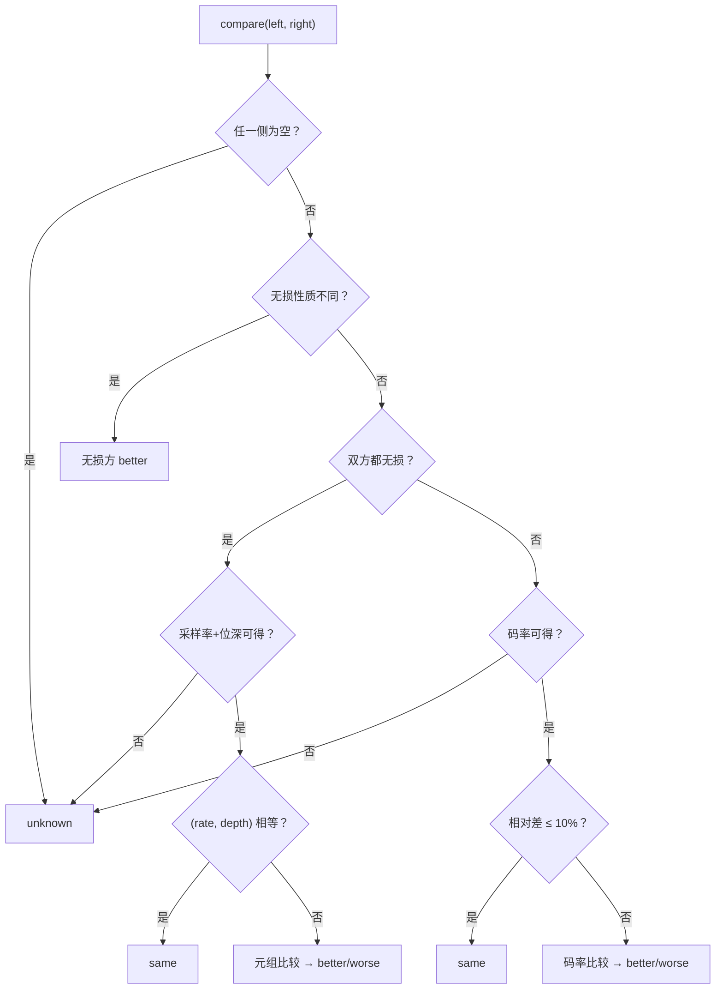

格式分层：

| 类别 | 扩展名 |
|---|---|
| 无损（全部） | `.flac` `.ape` `.wav` `.dsf` `.dff` `.aif` `.aiff` `.alac` |
| 压缩无损 | `.flac` `.ape` `.alac` |
| 未压缩无损 | `.wav` `.aif` `.aiff` |

`BITRATE_TOLERANCE = 0.10`：同一次转码的不同产物码率会有几个百分点浮动，10% 内视为同一水平，不互相替换。分母取两者中较大的码率：128k 与 140k 相差 12k，相对差 8.6%（同水平）；128k 与 160k 相差 32k，相对差 20%（真升级）。用相对差而不是绝对值，才不会把 128k 与 140k 的 12k 差距和 1000k 与 1012k 的 12k 差距一视同仁。

码率取值优先用容器报的，拿不到用 `size * 8 / duration` 估算。

`storage_preference()` 只在 `compare()` 已判 `same` 后调用，且刻意保守：

- 只比「压缩无损 ↔ 未压缩无损」；两种都是压缩无损（FLAC vs APE）判 `same`
- DSD（`.dsf`/`.dff`）不参与——DSD 转 PCM 本身就不是无损
- 规格读不出返回 `unknown`

### 10.6 跨集合的索引缓存

`services.steps._library_tracks()` 缓存库索引，键是 `LIBRARY_DIR`。目录变了才重建（`invalidate_library_cache()`）。规格缓存 `_quality_cache` 单独一份：重建库索引不必连带丢掉已读到的规格。

网页上「替换库内旧版本」是全流程风险最高的动作，所以：

- `upgrade` 必须显式指定 `paths`，不允许「不指定就全做」
- `replaces` 里每个库内路径必须在预览中出现过，防止伪造路径去动库里任意文件
- `upgrade` 动的是库存量文件，无论 `action` 选什么都进 `DUPLICATE_DIR`，**永不进回收站**

---

## 11. 声纹识别与比对

两条独立链路，用途不同：

| 链路 | 实现 | 用途 | 是否需要网络 |
|---|---|---|---|
| AcoustID / MusicBrainz | `fingerprint/matcher.py`（经 `acoustid` / `musicbrainz`） | 从音频反查标签 | 是 |
| soundalike 本地声纹 | `services/soundalike.py` + `tools/soundalike*` | 库内声纹查重 | 否（本地库） |

两者都用 **Chromaprint 指纹**（由 `fpcalc` 计算），但一个查云端数据库，一个比本地声纹库。

### 11.1 AcoustID 链路

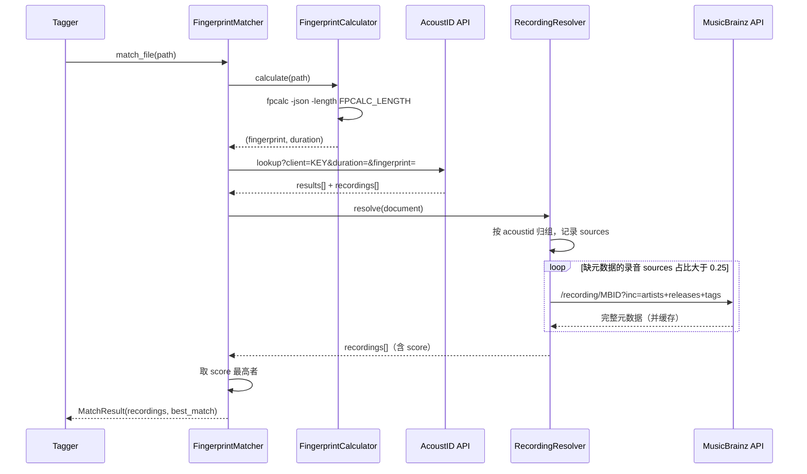

指纹长度 `FPCALC_LENGTH` 默认 120 秒。`fpcalc` 返回码 3 表示「有解码警告但有结果」，仍按成功处理（只打 warning）。

**分数合成**（`RecordingResolver._parse_recording_map`）：

```
score = min(sources / max_sources, 1.0) × 100 × result_score
```

- `sources`：有多少条 AcoustID 结果指向同一录音。共识越多越可信，这是抗误匹配的主要机制。
- `result_score`：AcoustID 对这条结果的置信度（0-1）。
- `max_sources`：本次查询内所有录音的最大 `sources`，用于归一化。

于是同一份指纹下，被 3 条结果同时指向的录音会明显高于只被 1 条指向的录音。

**缺元数据的补拉**：如果录音的 `sources / max_sources > 0.25` 且同类尚未补满 3 条，就去 MusicBrainz 拉完整信息。这样既补全了冷门曲目，又不会为排名靠后的候选付网络代价。

### 11.2 相似度算法（Picard 移植）

四个基础分数：

| 函数 | 含义 | 公式 |
|---|---|---|
| `similarity2(a, b)` | 多词字符串相似度 | 逐词取最佳匹配求和，除以 `alen + 剩余词数 × 0.4` |
| `_string_similarity(a, b)` | 单词相似度 | `1 - 编辑距离 / max(len)`，动态规划 |
| `length_score(a, b)` | 时长相似度 | `1 - min(\|a-b\|, 30000) / 30000`（毫秒） |
| `trackcount_score(a, b)` | 曲目数相似度 | 相等 1.0；实际少于候选 0.3；多于 0.0 |

`similarity2` 的分母里带 `0.4` 系数，作用是**惩罚未匹配的词**：`a` 的词全部匹配上时 `len(blist)` 归零，得分接近 1.0；`b` 还剩很多词没被匹配时，分母变大，得分被拉低。

加权组合用 `linear_combination_of_weights(parts)`（普通加权平均），权重来自 Picard：

| 维度 | 权重 | 说明 |
|---|---|---|
| `releasetype` | 14 | 最高：偏好官方发行 |
| `title` | 13 | 标题匹配最关键 |
| `length` | 10 | 时长 |
| `album` | 8 | 专辑标题（`_find_best_match` 内硬编码） |
| `artist` | 4 | 艺术家 |
| `date` | 4 | 发行日期 |
| `totaltracks` | 4 | 曲目数 |
| `releasecountry` | 2 | 国家（当前固定 0.5） |
| `format` | 2 | 介质（当前固定 0.5） |
| `isvideo` | 2 | 视频标志 |

发行类型分数：`Album 1.0`、`Single 0.8`、`EP 0.7`、`Compilation 0.6`、`Other 0.5`、`Broadcast 0.4`。

日期匹配是**分段函数**而非连续差值：

```
完全相同            → 1.00
同年                → 0.95
相差 ≤ 2 年         → 0.85
相差 > 2 年         → 0.00
候选无日期          → 0.25
```

最终 `similarity = linear_combination_of_weights(parts) × search_score`，`search_score = recording.score / 100`。多条 release 时取最高相似度的那条（专辑信息更可能是同一版）。

**再次强调**：`_find_best_match()` 需要调用方传 `metadata` 才执行。`Tagger.update()` 不传，所以主流程的实际排序依据是 11.1 的 AcoustID 合成分。相似度算法目前只服务于「显式传 metadata」的调用方。这是代码事实，不是设计意图的猜测。

### 11.3 soundalike 本地声纹去重

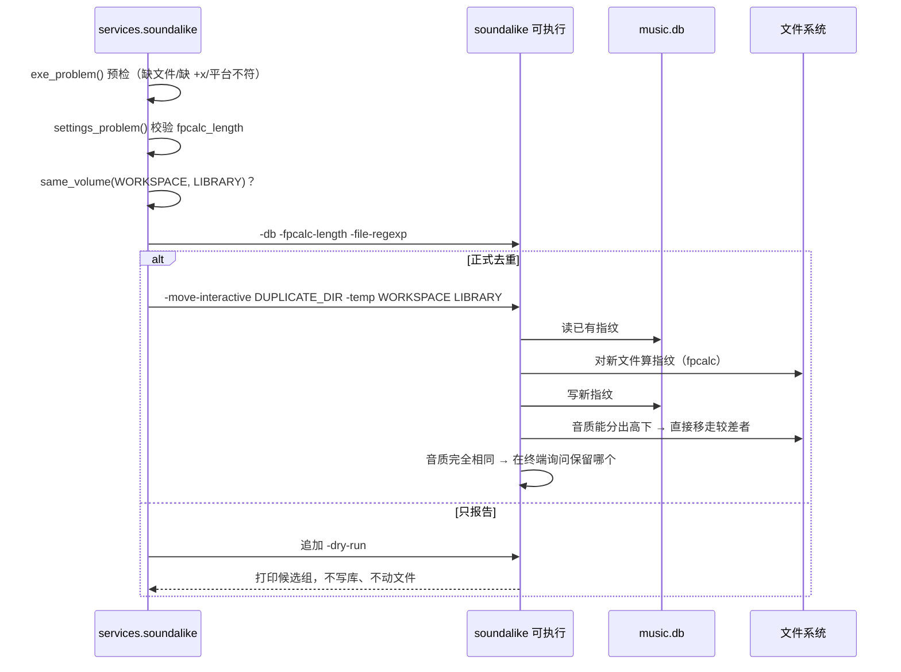

四条命令的差别是这张表的全部内容：

| 用途 | 入口 | 额外参数 | `-dry-run` | 写库 |
|---|---|---|---|---|
| 正式去重 | `run()` | `-move-interactive` | 否 | 是 |
| 只报告 | `report()` | `-move-interactive`（被 dry-run 抑制） | **是** | **否** |
| 建库/补库 | `init_db()` | 无 | 否 | 是 |
| 一致性校验 | `check()` | `-check` | — | 否 |

**`report()` 必须走 `-dry-run` 是踩过坑的**：以前它跑的是「正经扫描、只是不带移动参数」，副作用是把指纹写进库；下一轮正式运行时这些文件被当成「已经处理过」，重复就再也报不出来。现在统一走试运行——能复用库里已有指纹，但一份都不写。

`-file-regexp` 必须显式传。soundalike 内置的正则不含 `.dsf`/`.dff`，而 DSD 恰恰是「不同音质同一首歌」里最该留下的那份。实际正则是 `config.AUDIO_EXTENSIONS` 与 `_EXTRA_SCAN_EXTENSIONS` 的并集：

```python
r'(?i)\.(aif|aiff|aifc|ape|dff|dsf|flac|m4a|mp3|oga|ogg|opus|tta|tak|wav|wma|wv)$'
```

`-temp` 要求工作区与库目录**同盘**。soundalike 用「第一个音乐目录」推算相对路径，跨盘时 `filepath.Rel` 直接报错，整次扫描失败。所以先判 `same_volume()`，不同盘就不把工作区纳入范围，而不是跑到一半才炸。

`_env()` 把 `tools/` 前置进 `PATH`：soundalike 只按 PATH 查 `fpcalc`，不读配置。macOS 上 fpcalc 随仓库放在 `tools/`，不注入就报 `fpcalc not in path`。

---

## 12. 归档

### 12.1 年代目录

```python
def decade_label(year):
    if year <= 1979:
        return '1950-1979'          # 早期录音稀疏，合成一个桶
    decade = (year // 10) * 10
    return f'{decade}-{decade + 9}'
```

为什么 1979 以前合并：1950-1979 三十年的曲目数量往往不如 1980 一个年代，单独开三个目录只有空壳。边界值 `1979` 落在合并桶里，`1980` 起才算 `1980-1989`。

### 12.2 归档判定

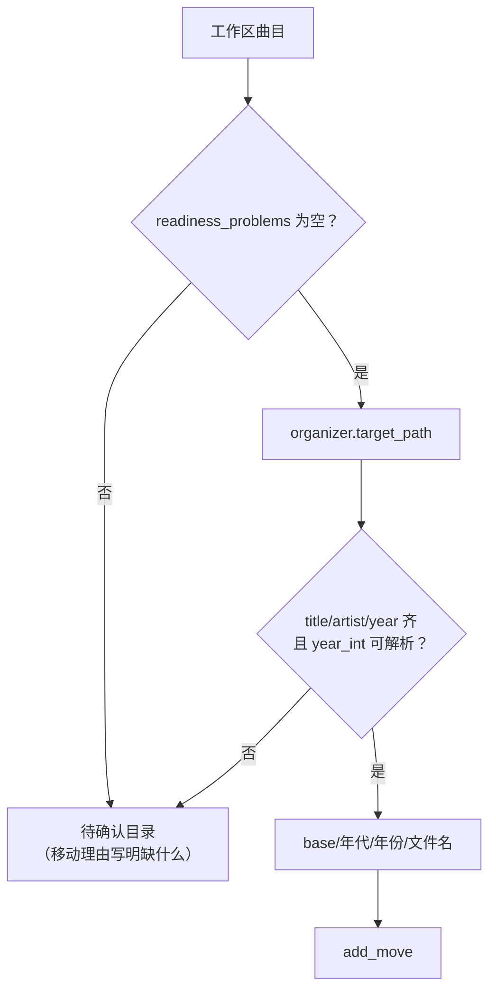

三层判定有重叠但语义不同：`readiness_problems` 是入库标准（含 album 与一致性），`target_path` 只要「能定目录」三件套。归档时先过第一层，所以过了它就必然有路径；`target_path` 返回 `None` 的那条分支是防御性兜底，正常流程不应触发。

`into_library=False` 时基准目录是工作区，用于「先在工作区内整理成年代结构、暂不入库」。

### 12.3 归档不判定重复

`plan_organize()` 只管目录，不查库。查重是第 6 步的事（`match_against`），归档是第 8 步。分开的理由：查重需要人工确认（`upgrade` 要动库存量文件），归档要一次跑完；混在一起会让「归档」这个本该纯粹的步骤带上高风险决策。

---

## 13. 统一执行层 `Plan`

### 13.1 三种操作

| 动作 | 语义 | 撞车策略 |
|---|---|---|
| `move` | 移到指定目标 | 目标存在 → 加 `_1`/`_2` |
| `rename` | 同目录改名 | 目标存在 → **抛异常**（只改大小写除外） |
| `trash` | 移入回收站 | 回收站内同名 → 加 `_1` |

`rename` 撞车必须失败，这是硬约束：静默加 `_1` 会造出一个查不出来的重复文件，而下一次查重又会把它判成重复，形成「改了名又冒出一个重复」的循环。

「只改大小写」例外：Windows 大小写不敏感，`_same_path` 判为同一文件时允许直接覆盖。

### 13.2 跨盘移动的原子性

```mermaid
sequenceDiagram
    participant P as _move_file
    participant S as 源盘
    participant D as 目标盘

    P->>S: os.replace(src, dst)
    alt 同盘
        S-->>P: 成功（原子改名）
    else EXDEV 跨盘
        P->>D: shutil.copy2(src, dst.part)
        P->>D: getsize(part) == getsize(src)?
        alt 大小不一致
            P->>D: unlink(part)
            P-->>P: 抛 OSError（放弃这次移动）
        else 一致
            P->>D: os.replace(part, dst)
            P->>S: unlink(src)
        end
    end
```

为什么不用 `shutil.move`：它跨盘时直接往目标路径写，中途被打断会留下一个**截断的目标文件**——看起来移动成功了，实际文件已损坏。先写 `.part`、校验大小、再改名，任何一步失败源文件都还在。

清理只针对自己刚建的 `.part`，不碰其他文件。

### 13.3 歌词伴随

音频移动/改名时同步搬走同名 `.lrc`。歌词失败**不影响主文件**（`except: pass`）——音频已经搬对了，为了歌词回滚整次移动代价更大。

### 13.4 journal

每条操作执行后写一行 JSONL 到 `log/` 下：

```json
{"time":"2026-11-07 09:45:33","plan":"归档-入库","action":"move",
 "src":"...","dst":"...","reason":"按年份归档 1998","ok":true,"error":""}
```

失败的操作用 `ok: false` + `error` 记录，且 `op.reason` 会追加失败原因。journal 写入失败**不影响主流程**——日志坏了不该让归档停下来，但这也意味着极端情况下可能缺少追溯记录。

顺序上先执行再写 journal，所以「journal 里有记录」等价于「这次操作确实尝试过」。恢复时按 `dst` 是否存在判断实际结果。

---

## 14. 关键参数

| 参数 | 配置项 | 默认 | 影响 |
|---|---|---|---|
| `DURATION_TOLERANCE` | `duration_tolerance` | 3.0 s | 时长聚类与跨集合同录音判定 |
| `BITRATE_TOLERANCE` | 常量 | 0.10 | 有损码率视为同水平的相对差 |
| `FPCALC_LENGTH` | `fpcalc_length` | 120 s | 指纹采样长度；改它必须重建声纹库 |
| `FINGERPRINT_THRESHOLD` | `fingerprint_threshold` | 50 | 声纹结果是否被采用 |
| `MAX_COVER_SIZE` | `max_cover_size` | 5 MB | 封面下载上限 |
| `SUBPROCESS_TIMEOUT` | `subprocess_timeout` | 3600 s | 所有外部程序超时 |
| `ENCRYPTED_SOURCE_MODE` | `encrypted_source_mode` | `return` | 加密原件去向 |
| `AUDIO_COUNT_LIMIT` | 常量 | 20000 | 初始化状态判定的计数上限 |
| `MAX_TABLE_ROWS` | 常量 | 200 | Markdown 报告正文行数上限 |
| `MATCHED_LIMIT` | 常量 | 50 | 单个工作区文件最多列出的库内对应文件数 |
| `SOURCE_THRESHOLD_NO_METADATA` | 常量 | 0.25 | 触发 MusicBrainz 补拉的 sources 占比 |
| `MAX_NO_METADATA_RECORDINGS` | 常量 | 3 | 同一结果最多补拉几条 |

配置优先级固定为**环境变量 > `config.ini` > 默认值**（见 [configuration.md](configuration.md)）。

---

## 15. 已知局限

这些是**刻意的取舍**，不是待修的 bug。改之前先读对应章节的理由。

| 局限 | 影响 | 为什么接受 |
|---|---|---|
| 时长聚类有容差边界 | 差值略大于 `duration_tolerance` 的同一录音会分到两簇（漏判） | 锚点聚类是 `O(n log n)`；全连接是 `O(n²)`，大库上不可行；边界效应交人工 |
| 歌名「一方包含另一方」判一致 | `晴天` 与 `晴天转多云` 判一致 | 反向收紧会误判 `晴天` vs `晴天 (Live)`，误判要搬文件 |
| 补全只填空缺、不覆盖 | 错误标签补不掉 | 已有值可能是用户手工改对的，自动覆盖风险更高 |
| 库索引不读标签 | 库里文件名不可信时（用户手工塞文件）会漏判 | 一万多首读标签要十几分钟，文件名是归档流程自己写的 |
| `report()` 不写声纹库 | 报告不产生指纹，下一轮还要重算 | 写库会让文件被当成「已处理」，重复再也报不出来 |
| `_find_best_match` 主流程未启用 | Picard 相似度权重实际不参与标签选择 | `Tagger` 不传 metadata；需要时可由调用方显式传 |
| 封面只认内嵌 | 同目录 `cover.jpg` 不算有封面 | 补封面写内嵌，判定必须看同一位置 |
| `Plan` journal 失败不报错 | 极端情况下缺追溯记录 | 日志故障不该中断归档 |

排查「为什么这个文件被判重复/未入库」请走 [troubleshooting.md](troubleshooting.md) 与 [self-check.md](self-check.md)。

---

## 16. 代码映射

| 算法 | 入口函数 | 唯一实现文件 |
|---|---|---|
| 初始化判定 | `library.status()` / `init_actions()` | `core/library.py` |
| 初始化执行 | `steps.init_library()` | `services/steps.py` |
| 扫描 | `scan.scan()` / `build_track()` | `core/scan.py` |
| 拷贝 | `ops.copy_items()` | `core/ops.py` |
| 解密编排 | `decrypt.decrypt_direct()` | `services/decrypt.py` |
| QQ 通道 | `qq.decrypt_backend()` / `_run_frida()` | `decrypto/qq.py` |
| um 封装 | `um.run()` / `build_command()` | `decrypto/um.py` |
| 标签读取 | `tags.read_meta()` / `read_quality()` | `core/tags.py` |
| 标签补全 | `Tagger.update()` | `tagger/__init__.py` |
| 在线打分 | `tag_score()` / `match_score()` | `core/scoring.py` |
| 文件名解析 | `parse_filename()` / `canonicalize()` | `core/naming.py` |
| 一致性 | `consistency_report()` / `readiness_problems()` | `core/check.py` |
| 自检 | `check_library()` / `plan_fixes()` | `core/check.py` |
| 集合内去重 | `find_duplicates()` | `core/dedupe.py` |
| 跨集合比对 | `match_against()` | `core/dedupe.py` |
| 音质比较 | `quality.compare()` / `storage_preference()` | `core/quality.py` |
| 声纹（云端） | `FingerprintMatcher.match_file()` | `fingerprint/matcher.py` |
| 声纹（本地库） | `soundalike.run()` / `report()` / `init_db()` | `services/soundalike.py` |
| 归档 | `organize.target_path()` / `plan_organize()` | `core/organize.py` |
| 执行层 | `Plan.add_*()` / `execute()` | `core/ops.py` |

改任何一条判定规则时：先改 `core/` 里的唯一实现 → 补 `tests/` 用例 → 同步 [rules.md](rules.md) → 若影响流程再同步 [workflow.md](workflow.md)。**不要在 `main.py` 或 `services/` 里另写一套**，那是同一事实出现两个版本的开始。
