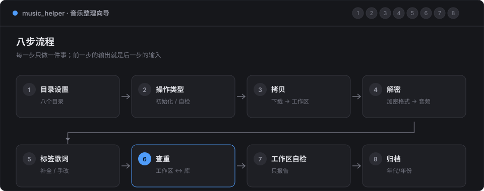
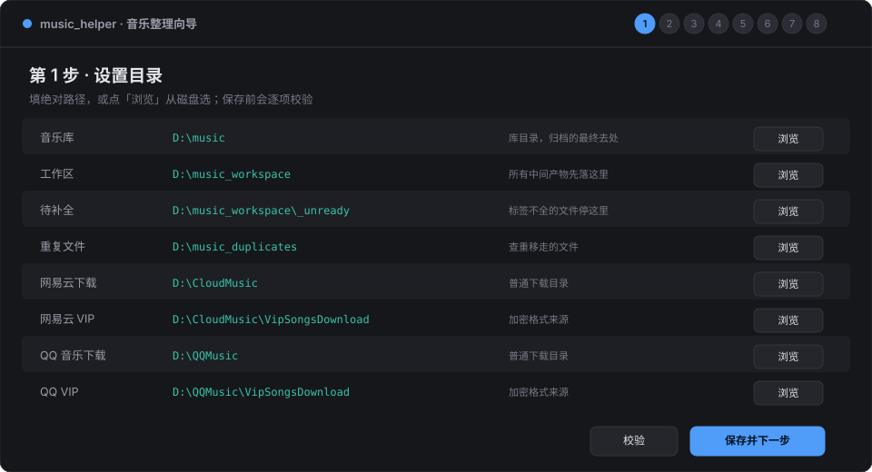
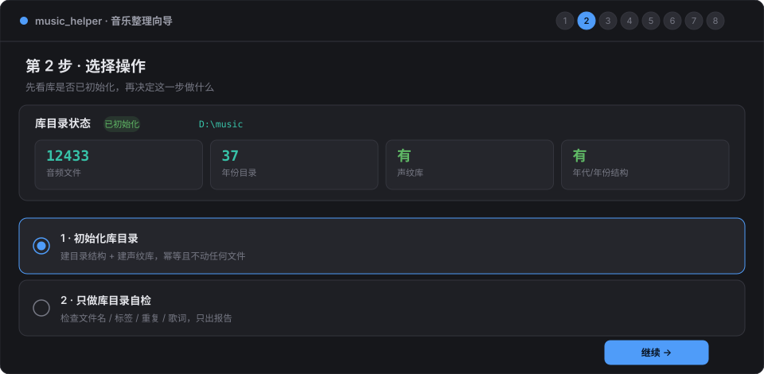
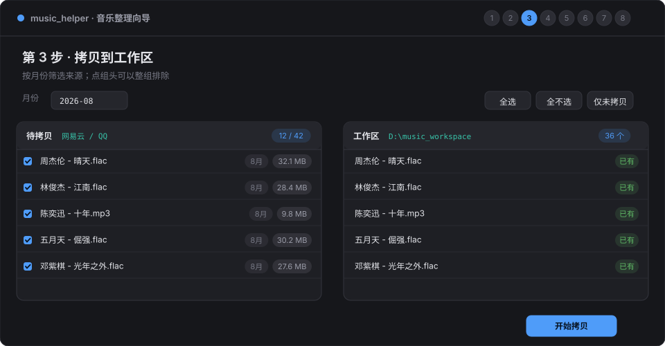
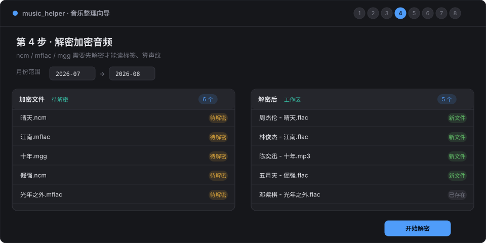
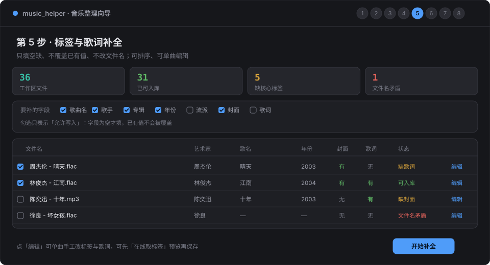
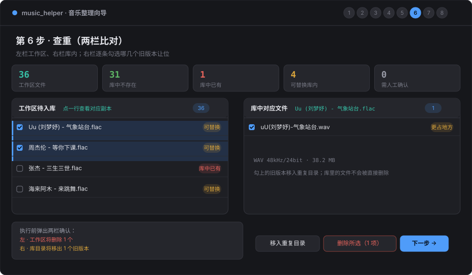
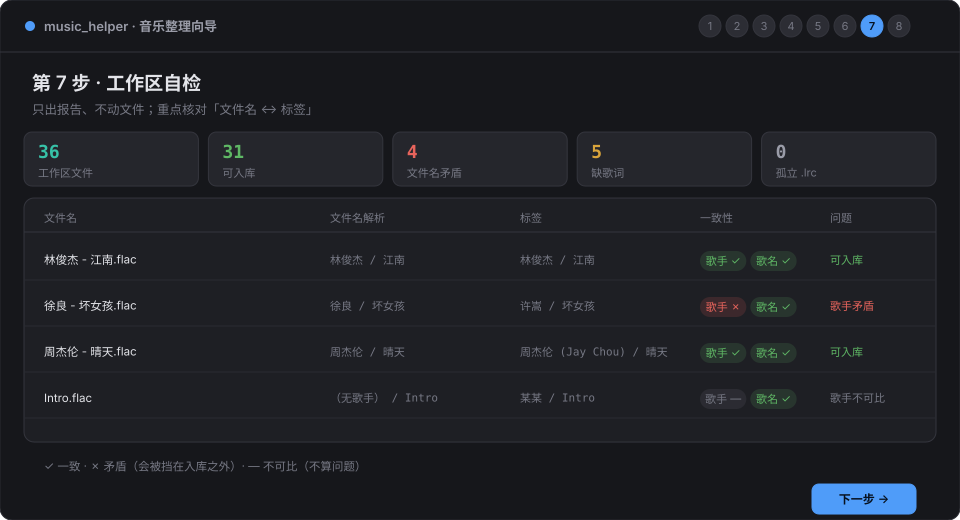
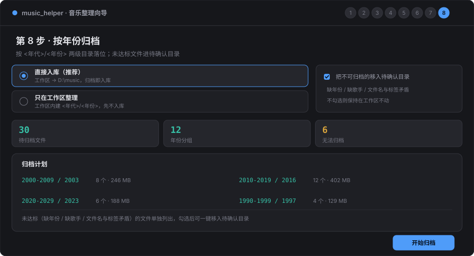

# Web 操作说明

> 面向使用者：每一页做什么、按钮会动哪些文件、哪些地方必须先确认。
> 判定规则的原理不在本文，见 [rules.md](rules.md)；界面架构见 [web-wizard.md](web-wizard.md)。

整个向导是八步，一次只做一件事，前一步的产物就是后一步的输入：



## 0. 启动与通用操作

### 0.1 启动

```bash
python -m uvicorn web.api:app --host 127.0.0.1 --port 8000
```

浏览器打开 `http://127.0.0.1:8000`。服务只监听本机，不要绑 `0.0.0.0`——
这个进程能读写你指定目录里的所有文件。

### 0.2 界面结构

| 区域 | 位置 | 作用 |
|---|---|---|
| 步骤条 | 顶部 | 显示当前在第几步，已完成的步骤可以点回去看 |
| 标题行 | 内容区顶部 | 步骤名 + 一句说明 + 右侧的「刷新 / 重新扫描」 |
| 统计块 | 标题下方 | 这一页关心的几个数字，颜色代表状态（青=中性、绿=好、黄=注意、红=有问题） |
| 操作区 | 中间 | 表格 / 双栏 / 表单 |
| 底部按钮 | 最下方 | 左「上一步」、右「执行 / 下一步」，中间是提示 |

### 0.3 三个通用约定

1. **所有耗时操作都在后台任务里跑**。点执行后出现进度条，逐条显示当前处理的文件；
   点开「运行日志」能看到每一行的结果。任务串行执行，同一时间只跑一个。
2. **页面上的数字是「扫描那一刻」的**。做完一步之后，下一步会自动重新读盘；
   如果手工在资源管理器里改过文件，点页面右上角的「刷新 / 重新扫描」。
3. **删除都不是真删除**。所有删除动作只是移动到 `log/_trash`，移动动作的目标目录也都
   在页面顶部写明。真正的清理请你手工做。

### 0.4 结果弹窗

执行完会弹一个结果框：左边四个数字（计划 / 完成 / 跳过 / 失败），下面逐条列出每个文件
的去向和原因。**失败项不要忽略**——多数是文件被占用、目标已存在、权限不足，处理掉之后
重新执行一次即可。

## 1. 第 1 步 · 设置目录



八个目录，前四个是流程自己的，后四个是下载来源。

| 目录 | 必填 | 作用 |
|---|---|---|
| 音乐库 | 是 | 归档的最终去处，按 `<年代>/<年份>` 存放 |
| 工作区 | 是 | 所有中间产物先落这里；第 5–8 步都只看这个目录的顶层 |
| 待补全 | 是 | 标签不全 / 文件名与标签矛盾的文件停这里 |
| 重复文件 | 是 | 查重时移走的文件；库内旧版本也让位到这里 |
| 网易云目录 | 是 | 普通下载目录（mp3 / flac） |
| 网易云 VIP 目录 | 否 | `.ncm` 来源；留空自动取「网易云目录/VipSOngsDownload」 |
| QQ 音乐目录 | 是 | 普通下载目录 |
| QQ 音乐 VIP 目录 | 否 | `.mflac` / `.mgg` 来源；留空规则同上 |

### 操作

1. 点「浏览」从磁盘选，或在输入框里直接粘贴路径；
2. 目录不存在时，右侧会出现「新建」按钮，可以直接建；
3. 点「校验」或「保存并下一步」，保存在 `config.ini` 的 `[paths]` 段。

### 会被拦下的四种情况

- **留空的必填项**；
- **相对路径**（必须 `D:\music` 这种绝对路径）；
- **路径已存在但不是目录**（例如写成了一个文件）；
- **两个目录相同，或四个结构目录互相嵌套**——「移动到自己里面」必然出错。

VIP 目录留空是合法的：它跟随对应的下载目录，页面上会显示继承后的实际路径。

### 注意

改了「音乐库」之后，第 6 步的库索引会作废，下次比对会重新扫一遍（第一次会慢几十秒）。

## 2. 第 2 步 · 选择操作



### 先看库状态

四个数字决定这一步能做什么：

| 指标 | 含义 |
|---|---|
| 音频文件 | 库目录里的音频数量（超过两万显示 `20000+`，不再细数） |
| 年份目录 | 识别到多少个 `2020` 这样的年份目录 |
| 声纹库 | 声纹索引文件是否存在 |
| 年代/年份结构 | 库是否已经是 `<年代>/<年份>` 两级结构 |

### 两个选项

| 选项 | 做什么 | 什么时候用 |
|---|---|---|
| 1 · 初始化库目录 | 建目录结构 + 建声纹库。**幂等，不动任何文件** | 第一次用；换了库目录；声纹库丢了 |
| 2 · 只做库目录自检 | 检查文件名 / 标签 / 重复 / 歌词，只出报告 | 想看看现有库有多少问题，不打算马上改 |

库未初始化时，选项 2 不可点——先初始化，后面的步骤才有意义。

初始化是幂等的：目录已存在就跳过，声纹库已存在就不重建。安全，可以重复点。
声纹库建库要扫全库，一万多首大约几分钟，期间进度条会显示扫描数。

做完这一项会回到本页，状态自动刷新。

## 3. 第 3 步 · 拷贝到工作区



把下载目录里的**普通音频**复制到工作区。VIP 子目录（加密格式）不在这一步，留给第 4 步。

### 操作

1. 选月份（只处理该月下载的文件），或选一个月份区间；
2. 左栏按来源目录分组，每个组头有复选框——取消勾选就是整组不拷；
3. 右栏是工作区现状，同名文件会标「工作区已有同名」；
4. 点「开始拷贝」。

### 规则

- **只复制，不移动**：源文件留在下载目录，可重复执行；
- **同名不覆盖**：工作区已有同名文件时会加 `_1`、`_2` 后缀，两份都保留；
- 同名 `.lrc` 一起复制；
- 执行完一行一行回填结果（成功的实际落点、失败原因）。

拷贝完之后建议看一眼右栏：如果出现了大量 `_1` 后缀，说明同一个文件被拷了两遍，
第 6 步查重会把它们找出来。

## 4. 第 4 步 · 解密加密音频



网易云的 `.ncm`、QQ 音乐的 `.mflac` / `.mgg` 读不出标签、算不了声纹，必须先解密。

### 操作

1. 选月份范围（默认本月）；
2. 确认左栏的待解密清单——右栏是解密后预计的文件名，`已存在` 表示工作区里已经有同名文件；
3. 点「开始解密」。

### 规则

- 解密结果直接写进**工作区**，不经过暂存区，也不动源文件；
- 输出已存在时同样加 `_1` 后缀，不覆盖；
- 单个文件解密失败不影响其余，失败原因逐条列在结果里——常见的是密钥不匹配（换过账号）
  或文件本身损坏。

## 5. 第 5 步 · 标签与歌词补全



这一页干三件事：批量补全、排序查看、单曲手工改。

### 5.1 表格怎么看

| 列 | 说明 |
|---|---|
| 文件名 / 艺术家 / 歌名 / 专辑 / 年份 / 流派 | 点表头可以排序，再点一次反向；箭头表示当前方向 |
| 时长 | 读不出来显示 `—`，多半是文件损坏 |
| 封面 / 歌词 | 「有 / 无」，只看内嵌封面与同名 `.lrc` |
| 状态 | 可入库 / 缺核心标签 / 文件名矛盾 / 缺歌词 |
| 编辑 | 打开单曲编辑抽屉 |

有问题的字段会带颜色：缺的字段偏黄，矛盾的偏红。

### 5.2 选文件

顶部一排快捷选择：

- 全选 / 全不选；
- 仅缺标签 / 仅缺歌词 / 仅缺封面 / 仅文件名矛盾。

也可以逐行勾选。**只处理勾选的行**，其余文件原样保留。

### 5.3 字段开关

「要补的字段」是一组白名单：

- 勾上 = **允许写入这个字段**，不代表一定会写；
- 字段为空才填，**已有值不会被覆盖**；
- 所以「只补歌词」= 关掉其余五个字段和封面，只留歌词。

「声纹识别」勾上会先用 MusicBrainz 按音频本身匹配，更准但更慢；关掉只走 QQ 音乐和网易云。

### 5.4 单曲编辑

点某一行的「编辑」，右侧滑出抽屉：

1. 上方显示文件名与逐项一致性（歌手 ✓ / 歌名 ✓ / — 表示不可比）；
2. 「在线取标签」按当前标签或文件名去查，结果**只填进表单，不落盘**，你先看；
3. 表单留空表示「不改」，不是「清空」；
4. 歌词框留空不写，填了则整体覆盖同名 `.lrc`；
5. 点「保存」才写盘。

**编辑不改文件名**。文件名与标签矛盾时，改标签，别指望它顺手改名——
改名归第 8 步归档，因为它牵动重复判定与归档路径。

### 5.5 补全失败怎么办

常见原因：没有网络、该曲目在线库确实没有、文件被别的程序占用。
失败项在结果弹窗里逐条列出，处理完可以直接再点一次「开始补全」——已经填好的字段不会重复写。

## 6. 第 6 步 · 查重（工作区 ↔ 库目录）



入库前最后一道闸：**库里已经有的，不再入库**；**库里那份更差的，让位给这份**。

### 6.1 四种结论

| 结论 | 含义 | 允许的操作 |
|---|---|---|
| 库中不存在 | 库里没有这首歌 | 不用管，第 8 步会入库 |
| 库中已有 | 库里已有同等或更好音质的版本 | 勾选后 → 移走工作区这份 |
| 可替换库内 | 库里那份音质更低，或同音质但更占磁盘 | 勾选后 → 移走库里那份，这份入库 |
| 需人工确认 | 大小与时长都对不上，或规格读不出来 | 不提供勾选，先自查 |

「可替换库内」有两种依据，界面上分开写：

- **音质更低**：无损 > 有损、采样率 / 位深更高、码率更高；
- **同音质更省磁盘**：都是 44.1kHz/16bit 的 WAV 与 FLAC，声音一样，但 FLAC 只有一半体积。

第二种**不是音质升级**，只是换一个更省的容器。你不想动就取消勾选。

### 6.2 两栏怎么看

- **左栏**是工作区待入库的文件。点任意一行，右栏就显示库里与它对应的副本。
- **右栏**是 1:N 的——同一首在库里可能有好几份（不同年份目录、不同版本）。
  每一份单独一行，勾上表示「这一份让位」。
- 右栏的「保留」标记表示那一份不会被移动：它要么比工作区这份更好，要么音质相同。

### 6.3 默认勾选规则

| 状态 | 默认 |
|---|---|
| 库中已有 | **勾选**（只动工作区，随时可以从重复目录拿回来） |
| 可替换库内 | **不勾选**（会动库里的存量文件，必须逐项确认） |

想一次全处理，点「全选可处理」；想只看某一类，点「仅库中已有」或「仅可替换」。

### 6.4 三个按钮

| 按钮 | 做什么 | 落点 |
|---|---|---|
| 移入重复目录 | 工作区那份移走，留一份可对照的副本 | `重复文件` 目录 |
| 删除所选 | 工作区那份删掉 | `log/_trash` 回收站，不进重复目录 |
| 下一步 | 进入第 7 步 | — |

两个执行按钮都会弹确认框，里面是**两栏摘要**：

```
工作区 · 将删除 3 个
   张杰 - 三生三世.flac
   ...
库目录 · 将移出 2 个旧版本（进重复目录，不删除）
   库 uu(刘梦妤)-气象站台.wav
   ...
```

看清楚再点确认。这一步没有「撤销」，只有「从重复目录 / 回收站手工搬回来」。

### 6.5 库内文件永不直接删除

即使你在网页上点了「删除」，**库里被替换的文件也只进「重复文件」目录**，不进回收站。
这条限制是写死的，因为库目录是长期资产，误删的代价远高于多占一点磁盘。

### 6.6 常见情况

**「可替换库内」里我取消了右栏全部勾选？**
这一项本次不做处理：库里保留原样，工作区这份也不动。确认框里会提示有几项被跳过。

**同一首歌库里有两份，我只想替换其中一份？**
右栏逐行勾选，只留要替换的那份。执行后另一份原样保留。

**为什么有的文件勾不上？**
「需人工确认」和「库中不存在」都不提供勾选：前者程序不下结论，后者没有可处理的动作。

**这一页很慢？**
库里一万多首，第一次比对要 stat 全库（约 3 秒），之后有缓存。改了库目录才会重扫。
点「重新扫描库」会强制刷新缓存。

## 7. 第 7 步 · 工作区自检



只读，不动任何文件。归档前最后看一眼。

### 7.1 看什么

| 指标 | 含义 | 怎么处理 |
|---|---|---|
| 可入库 | 标签齐全、年份可解析、文件名不矛盾 | 直接进第 8 步 |
| 文件名与标签矛盾 | 歌手或歌名两边对不上 | 回第 5 步用「编辑」改 |
| 标签不完整 | 缺歌曲名 / 歌手 | 回第 5 步补全 |
| 文件名不规范 | 没有「歌手 - 歌名」结构 | 第 8 步归档时统一处理 |
| 缺歌词 / 孤立 .lrc | 有音频没歌词，或有歌词没音频 | 补歌词，或手工清理孤立文件 |
| 工作区内重复 | 工作区里自己就有两份同名 | 少见，先看是不是拷贝重复了 |

### 7.2 一致性的三个符号

| 符号 | 含义 | 算问题吗 |
|---|---|---|
| ✓ | 一致 | 否 |
| ✗ | 矛盾 | **是**，会被挡在入库之外 |
| — | 不可比 | 否 |

「—」出现在：文件名没有「歌手 - 歌名」结构、标签里没有歌手、群星合辑。
**它只是这一维度没法比，不是错误**，所以不会把文件挡在库外。

歌手维度是宽松的：`周杰伦` 与 `周杰伦 (Jay Chou)` 算一致，`Various Artists` 与任何歌手都算一致。
这是刻意的——误判会把正常文件搬进待补全目录。

### 7.3 怎么修

- 标签问题 → 第 5 步「编辑」；
- 文件名问题 → 第 8 步归档时按标签补全；按标签改名只在「标签齐全且与文件名不矛盾」时进行；
- 不看也能继续，但「文件名与标签矛盾」的文件在第 8 步会被移入待补全目录。

## 8. 第 8 步 · 按年份归档



### 8.1 归档到哪里

| 选项 | 结果 |
|---|---|
| 直接入库（推荐） | 工作区 → 音乐库，`<年代>/<年份>/歌手 - 歌名.flac` |
| 只在工作区整理 | 在工作区里建同样的两级结构，先不入库，方便再核对一遍 |

「把不可归档的文件移入待确认目录」默认勾选。不勾就留在工作区不动，
但下一轮还会出现在这里。

### 8.2 归档计划

按 `年代 / 年份` 分组，显示每组多少文件、多少体积。先看这个清单，
有不对的年份说明标签里的年份写错了，回第 5 步改。

### 8.3 无法归档

缺年份、缺歌手、文件名与标签矛盾的会单独列出，附带原因。勾选移入的话，
它们进「待补全」目录，不会进库。

### 8.4 执行完

完成后点「完成」回到第 2 步，处理下一批。库里的新文件已经可以被下一轮的查重看到
（第 6 步会重新扫库）。

## 9. 任务面板与失败处理

执行任何一步都会出现任务面板：

```
工作区查重 · 处理中          [执行中]   周杰伦 - 晴天.flac     12 / 36
▓▓▓▓▓▓▓▓░░░░░░░░░░░░
▸ 运行日志（36 行）
```

- 进度条按「已处理 / 总数」推进；
- 日志每行一条，失败的会有红色标记；
- 任务跑的时候按钮变灰，不要重复点；
- 关掉浏览器不影响后台任务，重新打开页面能看到任务列表。

**失败项**一般是：

| 现象 | 原因 | 处理 |
|---|---|---|
| 目标已存在，拒绝改名 | 归档目录里已有同名文件 | 先查重，或手工确认要保留哪份 |
| 文件被占用 | 播放器 / 标签编辑器开着 | 关掉程序再执行 |
| 源文件不存在 | 扫描后被手工移走 | 刷新页面重来 |
| 写入标签失败 | 格式不支持或只读 | 检查文件属性 |

## 10. 常见问题

**Q：第 2 步显示「未初始化」，但我的库里有文件。**
初始化只建结构和声纹库，不判断有没有文件。库目录里已经有音频也算「未初始化」——
因为声纹库或月份目录结构还没建。点选项 1 跑一次即可，不会动文件。

**Q：第 6 步说「库中已有」，可我明明没有这首歌。**
先看右栏列出的库内文件：很可能是同名不同版本（Live / Remix / 伴奏），或者
文件名相同但内容不同。判定用了「大小相同」或「时长差 ≤ 3 秒」两道关，
对不上就会落到「需人工确认」而不是「库中已有」。

**Q：为什么第 6 步要把库里的文件移走？我不想动库。**
「可替换库内」默认不勾选。只要不勾，第 6 步只处理工作区那份。

**Q：删除的文件能找回吗？**
`log/_trash` 下按原文件名存放，直接拖回去即可。重复目录里的文件同理。

**Q：向导做到一半关了网页，会丢数据吗？**
不会。每一步的产物都在磁盘上，重新打开从当前步骤继续。但正在跑的任务会随后端进程
一起结束，重启后需要重新点一次。

**Q：能不能跳过某一步？**
能。步骤条可以点已完成的步骤。但第 6 步查重跳过的话，库里可能出现重复文件，
第 8 步归档不会替你拦。

## 11. 安全边界

写在这里，是为了让你知道哪些操作是「可恢复的」，哪些要谨慎：

| 操作 | 可恢复性 |
|---|---|
| 拷贝到工作区 | 源文件还在，随时重做 |
| 解密 | 源加密文件不动，输出可删了重来 |
| 补全标签 | **不可撤销**（原标签被覆盖前没有备份），但只填空缺，风险低 |
| 单曲改标签 | **不可撤销** |
| 工作区查重（移入重复目录） | 从重复目录搬回 |
| 工作区查重（删除） | 从 `log/_trash` 搬回 |
| 库内旧版本让位 | 从重复目录搬回 |
| 归档 | 从库里搬回工作区；文件名可能已按标签变化 |

所有实际动作都记在 `log/journal.jsonl`：时间、动作、源、目标、结果。
出问题时先看这个文件，它比页面上的弹窗记得久。

规则层面的细节（为什么这样判、边界在哪）见 [rules.md](rules.md)。
